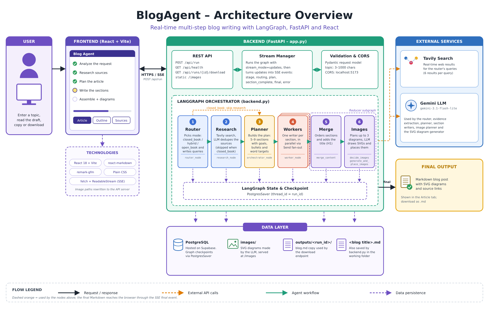

# Multi-Agent Blog Writer

An agentic workflow that researches, plans, writes and illustrates a technical blog post from a single topic. A router decides whether web research is needed, a planner outlines the article, section writers work **in parallel**, and a reducer merges everything and adds SVG diagrams. Progress streams to the browser in real time, so you watch the article appear section by section.

**Live demo:** https://multi-agent-blog-writer-1.onrender.com/

>> **Note:** This project is deployed on Render's free tier. The backend may go to sleep after a period of inactivity. When you open the application for the first time, please wait up to **2 minutes** for the backend to spin up. The first response may take longer than usual.
---

## Why this project

Writing a good technical post takes research, a clear structure and a lot of time. Asking a chatbot for a whole article in one prompt usually gives generic text, invented facts and no sources.

Multi-Agent Blog Writer solves this by:

- Deciding up front whether the topic needs current information (web research) or is evergreen.
- Searching the web with Tavily only when it is needed, and deduplicating the results into an evidence pack.
- Planning the article first: 5 to 9 sections, each with a goal, concrete bullets and a target word count.
- Writing all sections in parallel, so the article is ready much faster than one long generation.
- Allowing claims about recent events only when they are backed by a source URL in "open book" mode.
- Adding up to 3 simple technical diagrams, drawn as SVG by the LLM.
- Streaming every step to the UI, so you can see the progress, the outline and the sources while it runs.
- Saving the workflow state in PostgreSQL through LangGraph checkpoints.

---

## Architecture and overall flow



**How a topic moves through the graph**

1. **Router (`router_node`)**: picks a mode (`closed_book`, `hybrid` or `open_book`) and writes search queries when research is needed.
2. **Research (`research_node`)**: runs Tavily searches for every query, then an LLM turns the raw results into a deduplicated evidence pack. Skipped for `closed_book` topics.
3. **Planner (`orchestrator_node`)**: builds the plan, with the title, audience, tone, and 5 to 9 section tasks.
4. **Fan-out (`fanout`)**: sends one task to a worker per section using LangGraph `Send`.
5. **Workers (`worker_node`)**: each worker writes one Markdown section in parallel, following the goal and bullets of its task.
6. **Reducer subgraph**:
   - `merge_content` puts the sections in order and adds the blog title.
   - `decide_images` plans up to 3 diagrams and inserts placeholders.
   - `generate_and_place_images` asks the LLM to draw each diagram as SVG, saves it under `images/` and puts it into the article.
7. **Final output**: the finished Markdown is streamed to the browser, and a copy is saved to `outputs/<run_id>/blog.md` for the download button.

**Research modes**

| Mode | Used for | Research |
|---|---|---|
| `closed_book` | Evergreen concepts and fundamentals | No |
| `hybrid` | Mostly evergreen, but needs up-to-date tools or examples | Yes, sources cited where used |
| `open_book` | "Latest", "this week", rankings, pricing, policy | Yes, every claim needs a source URL |

---

## Tech stack

| Layer | Technology |
|---|---|
| Agent workflow | LangGraph (with a reducer subgraph) |
| LLM | Google Gemini (`langchain-google-genai`, `gemini-3.1-flash-lite`) |
| Web search | Tavily |
| State and checkpoints | PostgreSQL (Supabase) with `langgraph-checkpoint-postgres` |
| Backend API | FastAPI, Uvicorn, Server-Sent Events (SSE) |
| Frontend | React, Vite, react-markdown, hand-written CSS |
| Hosting | Render (Web Service + Static Site) |

---

## Project structure

```
Multi-Agent-Blog-Writer/
├── Backend/
│   ├── app.py                      # FastAPI app: /api/run (SSE), download, health
│   ├── backend.py                  # LangGraph workflow: router, research, planner, workers, reducer
│   ├── docs/
│   │   └── blog_agent_architecture.png
│   ├── images/                     # generated SVG diagrams (created at runtime)
│   ├── outputs/                    # one blog.md per run (created at runtime)
│   └── requirements.txt
├── Frontend/
│   ├── src/
│   │   ├── api/streamRun.js        # POST + SSE stream reader
│   │   ├── state/runReducer.js     # run state built from the stream events
│   │   ├── hooks/useBlogRun.js
│   │   ├── components/             # TopicForm, ProgressPanel, ArticleView, PlanView, SourceList, Markdown
│   │   ├── styles/                 # base.css, layout.css, components.css
│   │   ├── config.js
│   │   ├── App.jsx
│   │   └── main.jsx
│   ├── index.html
│   ├── package.json
│   └── vite.config.js
├── .gitignore
└── README.md
```

---

## Local setup

Set up the **backend completely first**, then the frontend.

### Prerequisites

- **Python 3.12** (recommended)
- **Node.js 18 or newer** and npm
- Git
- A PostgreSQL database for checkpoints (a free [Supabase](https://supabase.com/) project works well)
- API keys:
  - [Google AI Studio](https://aistudio.google.com/) for `GOOGLE_API_KEY`
  - [Tavily](https://tavily.com/) for `TAVILY_API_KEY`

### Step 1: Clone the repository

```bash
git clone https://github.com/nitishgarg1/Multi-Agent-Blog-Writer.git
cd Multi-Agent-Blog-Writer
```

---

## Part 1: Backend

### 1.1 Create a virtual environment and install dependencies

```bash
cd Backend
python -m venv venv
```

Activate it:

```bash
# macOS / Linux
source venv/bin/activate

# Windows (PowerShell)
venv\Scripts\Activate.ps1
```

Install the packages:

```bash
pip install -r requirements.txt
```

### 1.2 Create `Backend/.env`

Create a file named `.env` **inside the `Backend/` folder** and add your own values. Never commit this file.

```env
# LLM
GOOGLE_API_KEY=your_gemini_api_key

# Web search
TAVILY_API_KEY=your_tavily_api_key

# PostgreSQL password (used for LangGraph checkpoints)
DB_PASSWORD=your_database_password

# Frontend origin(s) allowed to call the API (comma separated)
FRONTEND_URL=http://localhost:5173

# Optional: LangSmith tracing
LANGCHAIN_TRACING_V2=true
LANGCHAIN_API_KEY=your_langsmith_api_key
LANGCHAIN_PROJECT=BLOG_WRITER_AGENT
```

### 1.3 Connect your database

The workflow saves its state with `PostgresSaver`. Open `Backend/backend.py`, find the `psycopg.connect(...)` call near the bottom, and set `host`, `port`, `dbname` and `user` to your own database. The password comes from `DB_PASSWORD` in `.env`.

The checkpoint tables are created automatically on the first start (`checkpointer.setup()`), so you do not need to run any SQL.

### 1.4 Start the backend

```bash
python app.py
```

Or run Uvicorn directly:

```bash
uvicorn app:app --reload --port 8000
```

The backend runs on **http://127.0.0.1:8000**. Check that it works:

- Health check: http://127.0.0.1:8000/api/health
- API docs: http://127.0.0.1:8000/docs

Keep this terminal running and open a new terminal for the frontend.

---

## Part 2: Frontend

Do this only after the backend is running.

### 2.1 Install dependencies

```bash
cd Frontend
npm install
```

### 2.2 Create `Frontend/.env`

Create a file named `.env` **inside the `Frontend/` folder**:

```env
VITE_API_URL=http://127.0.0.1:8000
```

Use the address and port where your backend is running, with no trailing slash. Vite reads this file only at startup, so restart `npm run dev` after changing it. The variable name must start with `VITE_`.

### 2.3 Start the frontend

```bash
npm run dev
```

Open **http://localhost:5173**, enter a topic and click **Write article**. For example:

- "Docker-in-Docker vs Docker-outside-of-Docker for Jenkins CI pipelines" (evergreen)
- "How self-attention works in transformers" (evergreen)
- "Latest open-source AI agent frameworks this month" (needs web research)

The **Progress** panel shows each step while the request runs. The **Article** tab fills in section by section, **Outline** shows the plan, and **Sources** lists the research results when web search was used.

If the page loads but the run fails immediately, open the browser's developer console. A CORS error means the frontend address is missing from `FRONTEND_URL` in `Backend/.env`. If you open the app at `http://127.0.0.1:5173` instead of `localhost`, add that origin too.

### 2.4 Production build (optional)

```bash
npm run build
```

The static files are created in `Frontend/dist`.

---

## Troubleshooting

| Problem | Likely cause and fix |
|---|---|
| "Can't reach the backend" in the UI | Usually CORS: add the frontend address to `FRONTEND_URL` on the backend and redeploy. Also check `VITE_API_URL`. If you are on Render, the backend may still be waking up. |
| First request is slow or fails on Render | The free tier spins down after 15 minutes without traffic and takes about a minute to start. Open `/api/health` once, wait, then try again. |
| Database connection or password error | Check `DB_PASSWORD`, and the `host`, `port` and `user` in `backend.py`. For Supabase, use the connection details from the session pooler. |
| Diagrams show as broken images | Make sure `app.py` mounts `/images` with `StaticFiles`. On Render's free tier, files in `images/` are deleted on every restart or redeploy. |
| Download returns 404 | The file in `outputs/` was removed after a restart. Run the topic again. |
| A diagram is missing from the article | The model did not return valid SVG for it. The article still works, and the error is printed in the backend log. |
| Quota or rate-limit errors from Gemini or Tavily | You hit a free-tier limit. Wait a few minutes or use a different key. |
| LangSmith shows no traces | Use `LANGCHAIN_TRACING_V2=true` (not `LANGCHAIN_TRACING`) together with `LANGCHAIN_API_KEY`. |

---

## Author

Built by Nitish Garg ([@nitishgarg1](https://github.com/nitishgarg1)).
